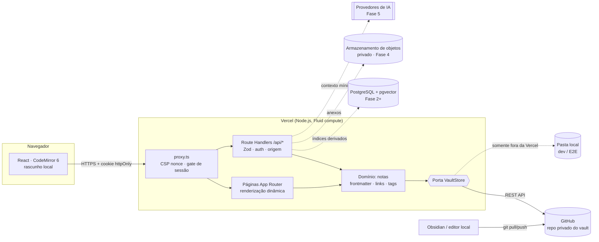
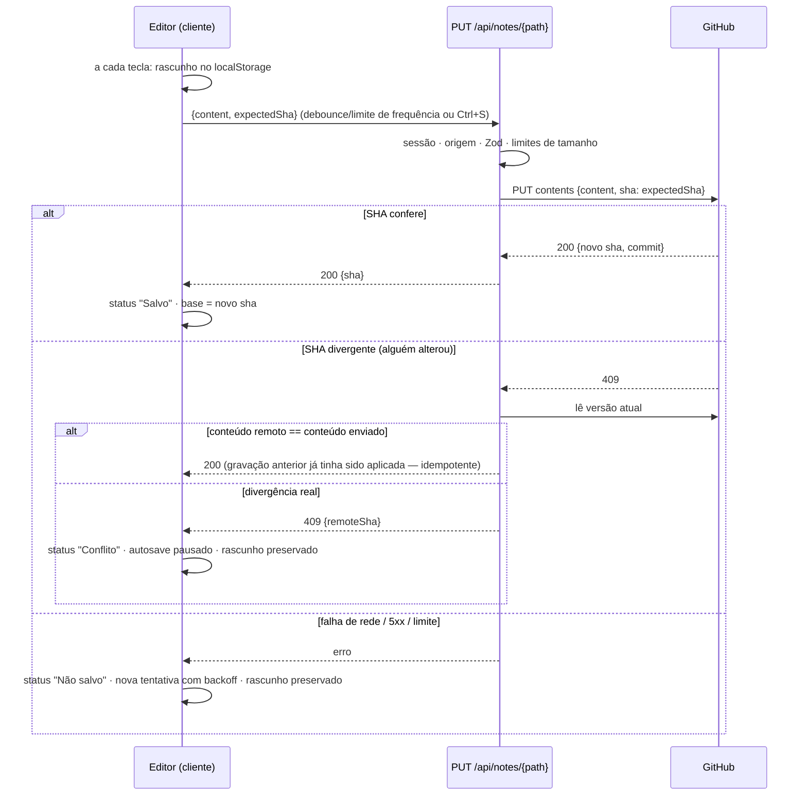

# Arquitetura

> Documento vivo. Decisões individuais e seus trade-offs ficam em [`docs/ADR/`](./ADR/README.md).
> Este arquivo descreve **como as peças se encaixam** e **o que já existe** versus **o que é plano**.

## 1. Visão geral

O Second Brain é uma aplicação web pessoal (usuário único) para capturar, organizar, conectar e
consultar conhecimento. Três regras estruturam toda a arquitetura:

1. **O Markdown no Git é a fonte canônica.** Cada nota é um arquivo `.md` com frontmatter YAML num
   repositório GitHub **privado e separado** (o _vault_). Ele continua legível e editável sem a
   aplicação — inclusive no Obsidian.
2. **Tudo o mais é derivado ou operacional.** Banco de dados, índices textuais e vetoriais são
   reconstruíveis a partir do vault. Dados que _não_ são deriváveis (ex.: decisão de rejeitar uma
   sugestão da IA) são explicitamente classificados e têm política própria de backup
   ([DATA_MODEL.md](./DATA_MODEL.md)).
3. **Nenhuma escrita silenciosa.** O servidor grava exatamente o conteúdo que o usuário vê; toda
   gravação verifica a versão atual (SHA do blob Git) e recusa sobrescrever mudanças concorrentes.



Linhas tracejadas são componentes planejados (ver [ROADMAP.md](./ROADMAP.md)).

## 2. Estado da implementação (alvo da Fase 1)

| Camada | Implementado | Arquivo principal |
| --- | --- | --- |
| Configuração validada (Zod) | 🚧 | `src/lib/config/env.ts` |
| Autenticação (senha scrypt + sessão JWT) | 🚧 | `src/lib/auth/*`, `src/proxy.ts` |
| Porta de persistência + adaptadores GitHub, pasta local e memória | 🚧 | `src/lib/vault/*` |
| Domínio de notas (frontmatter, wikilinks, tags, resolução de links, templates) | 🚧 | `src/lib/notes/*` |
| API de notas (listar, ler, criar, atualizar com controle de concorrência) | 🚧 | `src/app/api/notes/**` |
| Interface: árvore de pastas, editor, visualização, metadados, status de salvamento | 🚧 | `src/app/(app)/**`, `src/components/**` |
| Banco de dados, busca, backlinks, grafo, ingestão, IA | ⏳ planejado | [ROADMAP.md](./ROADMAP.md) |

## 3. Módulos e fronteiras

```
src/
├── proxy.ts                 # CSP com nonce + bloqueio de rotas sem sessão (1ª linha de defesa)
├── app/                     # Rotas (App Router). Sem regra de negócio aqui.
│   ├── (auth)/login         # Página pública de login
│   ├── (app)/               # Área autenticada (layout verifica sessão de novo)
│   └── api/                 # Route Handlers — contrato JSON explícito
├── components/              # UI (React). Nunca acessa segredos nem o vault diretamente.
└── lib/
    ├── config/              # Leitura e validação de variáveis de ambiente (server-only)
    ├── auth/                # Hash de senha, sessão, rate limit, guards
    ├── http/                # Respostas de erro padronizadas, checagem de origem
    ├── log/                 # Logger estruturado sem conteúdo de notas
    ├── vault/               # Porta VaultStore + adaptadores (GitHub, FS, memória)
    └── notes/               # Domínio puro: parsing, links, tags, nomes de arquivo, templates
```

Regras de dependência (verificadas em revisão de código):

- `lib/notes` é **puro** (sem I/O) e pode rodar no navegador e no servidor.
- `lib/vault` não conhece React nem Next.js; recebe dependências (ex.: `fetch`) por injeção, o que
  permite testar contra um GitHub falso e contra o GitHub real com a **mesma suíte de contrato**.
- `app/api/*` orquestra: valida entrada → autentica → chama `lib/notes/service` → traduz erros.
- Componentes cliente falam somente com `/api/*`. Tokens do GitHub, segredos de sessão e chaves de
  IA nunca chegam ao bundle do navegador (`server-only` + nenhuma variável `NEXT_PUBLIC_*` sensível).

Módulos futuros entram como novos diretórios em `lib/` (`index/`, `search/`, `ingest/`, `ai/`,
`jobs/`), cada um atrás de uma interface própria — sem reescrever os existentes.

## 4. Fluxos de dados

### 4.1 Abrir uma nota

1. `GET /notes/<caminho>` → `proxy.ts` valida o cookie de sessão (senão redireciona para `/login`).
2. A página (Server Component) chama `requireSession()` de novo (defesa em profundidade).
3. `notesService.getNote(path)` → `VaultStore.read(path)` → GitHub Contents API
   (`GET /repos/{owner}/{repo}/contents/{path}?ref={branch}`), que retorna conteúdo **e** SHA do blob.
4. O conteúdo bruto (frontmatter incluído) e o SHA vão para o editor; a visualização é renderizada
   no cliente a partir do mesmo texto.

Leitura é sempre "fresca" (sem cache entre requisições) na Fase 1: abrir uma nota mostra o estado do
GitHub naquele momento, inclusive mudanças feitas no Obsidian e já enviadas com `git push`.

### 4.2 Salvar uma nota (concorrência otimista)



Propriedades garantidas (e testadas):

- O status **"Salvo" só aparece depois que o servidor confirma** o novo SHA (cenário F).
- Uma edição concorrente nunca é sobrescrita em silêncio; o usuário escolhe entre recarregar a
  versão remota, salvar a sua como **cópia de conflito** (nova nota) ou sobrescrever conscientemente.
- O servidor não transforma o conteúdo: o campo `updated` do frontmatter é ajustado **no editor**,
  visível ao usuário, antes do envio.

Detalhes e justificativas em [ADR-0008](./ADR/0008-salvamento-confiavel.md).

### 4.3 Criar uma nota

`POST /api/notes {title, folder, type}` → nome de arquivo derivado do título (seguro em
Windows/macOS/Linux e compatível com links do Obsidian) → template com `id` (ULID), datas e tipo →
`VaultStore.create` falha se o arquivo já existir (nada é sobrescrito) → retorna o caminho criado.

### 4.4 Alterações feitas fora da aplicação

Fase 1: o vault é editado no Obsidian (ou qualquer editor), sincronizado com `git pull`/`git push`.
A aplicação vê a mudança na próxima leitura e a protege na gravação via SHA. Não há sincronização
automática bidirecional prometida. O fluxo recomendado e as regras de conflito estão em
[VAULT_SYNC.md](./VAULT_SYNC.md) e [ADR-0007](./ADR/0007-edicao-local-e-sincronizacao.md).

Fase 2 adiciona o **índice derivado** atualizado por webhook `push` do GitHub (com verificação HMAC),
reconciliação manual ("sincronizar agora") e varredura diária; cada linha do índice guarda o SHA do
blob, então reprocessar é idempotente e só o que mudou é reindexado.

### 4.5 Fluxos futuros (resumo)

- **Busca (Fase 2):** PostgreSQL full-text (`portuguese` + `unaccent`) e `pg_trgm` para títulos.
- **Ingestão (Fase 4):** recepção → validação de tipo/tamanho → extração → nota de fonte → metadados
  → IA opcional → indexação → sugestões → revisão. Estados: pendente, em processamento, concluído,
  concluído parcialmente, falhou, requer revisão. Uploads grandes vão do navegador direto para o
  armazenamento de objetos (limite de 4,5 MB por requisição nas funções da Vercel).
- **RAG (Fase 5):** pergunta → filtros → busca textual + vetorial → fusão (RRF) → trechos com origem e
  localização → resposta que só pode citar IDs de trechos recuperados → validação das citações no
  servidor → "evidência insuficiente" quando for o caso. Ver [ADR-0009](./ADR/0009-camada-de-ia.md).

## 5. Ambientes

| Ambiente | Vault | Banco | Autenticação | Observações |
| --- | --- | --- | --- | --- |
| Local (`npm run dev`) | Pasta local (`VAULT_STORE=fs`) **ou** repo GitHub de teste | — (Fase 2: Postgres local) | Senha local | Nunca use o vault real para experimentos destrutivos |
| Testes (Vitest/Playwright) | Fixtures **sintéticas** copiadas para `.e2e-vault/` | — | Senha de teste gerada no próprio teste | Sem rede externa |
| Preview (Vercel) | Repo GitHub **de teste** | Branch de banco (Neon) | Senha própria + Deployment Protection | Nunca aponte preview para o vault real |
| Produção (Vercel) | Repo GitHub privado do vault | Banco principal | Senha + (planejado) GitHub OAuth | Sem migrações destrutivas automáticas |

O adaptador de pasta local **recusa iniciar na Vercel** (sistema de arquivos efêmero).

## 6. Limites conhecidos que moldam o desenho

Fontes e datas de verificação em [ADR-0004](./ADR/0004-acesso-ao-vault-via-api-do-github.md) e
[ADR-0010](./ADR/0010-processamento-assincrono.md).

- **GitHub REST:** 5.000 requisições/hora por token; limites secundários para criação de conteúdo
  (por isso o autosave é limitado em frequência); Contents API lê até 1 MB pelo JSON padrão (até
  100 MB por blob); árvore recursiva truncada acima de 100 mil entradas/7 MB.
- **Vercel Hobby:** uso pessoal não comercial; cron no máximo 1×/dia; funções até 300 s; corpo de
  requisição/resposta até 4,5 MB.
- **Latência:** cada gravação é um commit via API (centenas de ms). O rascunho local cobre o intervalo.

## 7. Riscos técnicos

| Risco | Impacto | Mitigação |
| --- | --- | --- |
| Conflito entre edição no Obsidian e na web | Perda de dados | SHA esperado em toda gravação; cópia de conflito; nunca _force-push_ |
| Ruído de commits por autosave | Histórico difícil de ler; limites secundários | Debounce + intervalo mínimo entre commits; Ctrl+S imediato; trailer `Second-Brain-Origin` |
| Token do GitHub vazado | Acesso ao vault | Token _fine-grained_ restrito a 1 repositório; só no servidor; rotação documentada |
| XSS via conteúdo importado | Sequestro de sessão | Markdown sem HTML bruto; CSP com nonce; cookie httpOnly |
| Prompt injection em fontes (Fase 5) | Exfiltração / ações indevidas | Conteúdo como dado não confiável; IA sem ferramentas privilegiadas; citações validadas |
| Vault grande (milhares de notas) | Lentidão na árvore | Árvore em 1 chamada; índice no Postgres na Fase 2; paginação no grafo |
| Custos de IA | Gasto inesperado | Orçamento mensal configurável; registro de uso; modelos menores para tarefas simples |
| Dependência de fornecedores | Lock-in | Postgres padrão, S3-compatível, IA atrás de interface, Markdown aberto |
| Evolução rápida do Next.js | Quebras em atualizações | Versões fixadas; atualização deliberada com testes; ADR-0003 |
| Senha como único fator (Fase 1) | Força bruta | scrypt, rate limit, regra de rate limit no Firewall da Vercel, GitHub OAuth planejado |

## 8. Custos recorrentes estimados

Valores de referência coletados em 12/10/2026 — **confira as páginas de preço antes de contratar**.

| Item | Fase | Custo típico (uso pessoal) |
| --- | --- | --- |
| Vercel Hobby | 1 | US$ 0 (uso pessoal não comercial; se o uso for profissional/comercial, Pro: US$ 20/mês) |
| GitHub (repos privados) | 1 | US$ 0 |
| Neon Postgres Free (1 GB/projeto, 100 CU-h/mês, escala a zero) | 2 | US$ 0; acima disso, cobrança por uso |
| Armazenamento de objetos (Vercel Blob privado 1 GB grátis ou Cloudflare R2 10 GB grátis) | 4 | US$ 0 no início |
| Embeddings (ex.: 10 M tokens ≈ vault grande inteiro) | 5 | ≈ US$ 0,20 (modelos de US$ 0,02/1M) — reindexação só do que muda |
| Chat RAG (8 k tokens de entrada + 1 k de saída por pergunta) | 5 | ≈ US$ 0,001 (Haiku 5.5) · ≈ US$ 0,026 (Sonnet 5.5) · ≈ US$ 0,052 (Opus 5.5) por pergunta |

Com 20 perguntas/dia, o chat custa de ≈ US$ 0,80 a ≈ US$ 31/mês dependendo do modelo — por isso o
modelo é configurável por tarefa e existe orçamento mensal (Fase 5).
